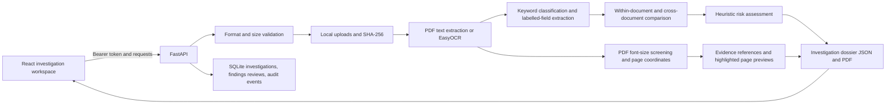

# FORENSAI — Document Intelligence and Forensics

FORENSAI is a local prototype for reviewing scanned or digital PDF and image documents. It combines text extraction/OCR, heuristic field extraction, PDF visual screening, cross-document comparison, evidence references, and a downloadable investigation dossier. Automated results are review leads—not proof of authenticity, fraud, or manipulation.

## Architecture and data flow



### Technologies and roles

- **React, Vite, Lucide**: upload, workflow progress, individual analysis results, dossier review, and highlighted evidence previews.
- **FastAPI**: upload validation, API orchestration, dossier and audit endpoints.
- **PyMuPDF**: digital PDF text, metadata, page structure, embedded image statistics, and PDF page rendering.
- **EasyOCR**: OCR for image files and PDF pages without selectable text. Configure English (`en`), Hindi (`hi`), Kannada (`kn`), or a supported combination before starting the backend.
- **NumPy and Pillow**: image conversion and evidence-preview rendering.
- **ReportLab**: PDF forensic report and investigation dossier generation.
- **SHA-256**: source-file fingerprinting and traceability.
- **SQLite**: saved investigations, document membership, review decisions, and audit history.

The prototype uses deterministic heuristics; it does not call an LLM or claim standards certification.

## Licensing assumptions

There is no project-level `LICENSE` or `COPYING` file in this repository. Do not assume the source is licensed for reuse or redistribution; the project owner should select and add a license before publishing it. Python and npm dependencies, as well as EasyOCR model weights downloaded at runtime, have their own terms that must be reviewed separately. The synthetic demo documents contain fictional data and do not change the software's licensing status.

## Run locally

Requirements: Python 3.10+ and Node.js 18+.

### Backend (Windows PowerShell)

From the project root:

```powershell
py -m venv .venv
.\.venv\Scripts\Activate.ps1
python -m pip install -r backend\requirements.txt
Copy-Item backend\.env.example .env
$jwtSecret = py -c "import secrets; print(secrets.token_urlsafe(48))"
(Get-Content .env) -replace '^FORENSAI_JWT_SECRET=.*$', "FORENSAI_JWT_SECRET=$jwtSecret" | Set-Content .env
Remove-Variable jwtSecret
notepad .env
python backend\main.py
```

The project-root `.env` is loaded automatically (the backend `.env` is also supported); process environment variables take precedence. In `.env`, set a private `FORENSAI_ADMIN_EMAIL`, a `FORENSAI_ADMIN_PASSWORD` of 12-128 characters, and optionally `FORENSAI_OCR_LANGUAGES=en`. The generated JWT secret is written to `.env` without being printed; keep the file private and never commit it. The application rejects a missing or shorter-than-32-UTF-8-byte secret at startup, and does not include the secret in error messages or logs. `.env` is ignored by Git. The environment-configured administrator is created on first database access; public registration creates investigator accounts only. The API listens at `http://127.0.0.1:8000`; interactive API documentation is at `/docs` and requires an account token. Access tokens expire after 30 minutes and are revoked when a user signs out.

### Frontend

```powershell
Set-Location ai-document-forensics-react
npm install
npm run dev
```

By default, the browser sends API calls to the frontend's own `/api` path, and the Vite development server proxies them to `http://127.0.0.1:8000`. This works when opening the frontend via localhost or the computer's LAN IP without making the backend publicly accessible. To proxy to another backend, set `FORENSAI_BACKEND_URL` before starting Vite. For a separately hosted frontend/API, set `VITE_API_BASE_URL` to the reachable API URL and configure that API's allowed CORS origin.

## Prototype capabilities

- Upload PDF, JPG, JPEG, or PNG files (15 MB each; PDFs are limited to 50 pages).
- Run OCR and extract labelled fields with page, evidence text, extraction method, and source regions where available. EasyOCR confidence comes from the recognizer; fallback extraction scores are explicitly heuristic.
- Extract common PAN and Aadhaar identifier labels as document-specific fields when they are present in text; the parser remains label-based and does not verify either identifier.
- Classify documents by keyword evidence, expose the uncalibrated score, and save manual corrections.
- Inspect text regions, page coordinates, headings, form-field labels, and possible table rows using layout heuristics.
- Run existing single-document fingerprint, metadata, PDF, visual, and image-statistics checks.
- Group up to 10 uploaded files into an investigation. Compare extracted field values within and across the submitted documents and identify differences for human review.
- For digital PDF text, flag extreme font-size outliers relative to a page median, retain PDF-point bounding boxes, and return page previews with those regions highlighted. Prominent synthetic/demo disclaimer outliers are retained with context and excluded from the heuristic risk score when every cited outlier is disclaimer text. For embedded PDF images, report exact SHA-256 duplicates with both source pages; this does not localize edits.
- Generate and retrieve a structured JSON dossier and downloadable PDF, including document overview, extraction, contextual findings, visual screening, evidence references, comparison table, heuristic risk contributions, investigator review decisions, summary, and limitations.
- Compare normalized identity fields, distinguish likely name spelling variations from conflicts, and report values that OCR did not extract without claiming the source field is absent.
- Show investigation totals, analyzed documents, documents with findings awaiting review, potential anomalies, and completed investigations from SQLite-backed API statistics.
- Protect API routes, including evidence previews, with individual investigator/admin accounts, scrypt password hashes, expiring and revocable JWTs, and investigation/document ownership checks. Admins can create accounts, assign roles, and disable accounts through user management.
- Save investigation history, document membership, manual finding-review decisions, and audit events in `forensicai.sqlite3`; `/audit-trail` returns recent activity without extracted document contents.
- Authenticate API and dashboard requests with expiring bearer JWTs. The browser keeps the token in session storage; explicit sign-out revokes it in SQLite. An environment-configured administrator can manage roles and accounts.
- Compare identity names, dates of birth, document numbers, addresses, gender, issue dates, and expiry dates when extracted. Name similarity is a human-review cue only; missing extraction is not treated as proof that a field is absent.
- Include a transparent, severity-weighted heuristic risk score and finding contributions in the investigation dossier. Review decisions are included in PDF dossier exports.
- Record per-document processing activities and evidence-preview access in the audit history; hashes are used to identify source file versions.
- Open original documents and coordinate-highlighted evidence previews from the dashboard.

## Limitations and responsible use

- Grouped documents are assumed to belong to the same case because the user submits them together. Confirm that relationship before interpreting a mismatch.
- Field extraction is based on English labels and regular expressions, including common PAN/Aadhaar field labels. It can miss values, confuse similarly labelled fields, and does not understand tables or handwriting reliably. Multilingual OCR language selection does not make the English field-label rules multilingual.
- Confidence values are uncalibrated heuristics, not probabilities. OCR output is not verified ground truth.
- Name similarity is a basic string comparison, not semantic identity resolution. It can miss legitimate spelling variants or flag unrelated names; review source evidence.
- The risk score is an ordering aid derived from finding severities, not a probability or fraud determination. A reviewer should inspect every cited source region.
- Visual screening currently flags unusually small/large text spans in digital PDF text and exact duplicate embedded images. Highlighted regions may be legitimate. Copy-paste localization, compression/edit analysis, signature or stamp detection, and face/photo comparison are not implemented.
- Cross-document name similarity is a basic string comparison, not semantic identity resolution. It can miss legitimate spelling variants or flag unrelated names; review source evidence.
- The risk score is an ordering aid derived from finding severities, not a probability or fraud determination. A reviewer should inspect every cited source region.
- No LLM-based contextual reasoning, external identity verification, multi-language recognition, or calibrated ML model is implemented.
- Uploads and generated PDFs are local filesystem artifacts; investigation metadata, account records, ownership, reviews, and token revocations are stored in SQLite. Existing ownerless records are assigned to the configured bootstrap administrator at database initialization; without that administrator they remain inaccessible to investigator accounts. This local prototype does not provide encryption at rest, retention controls, registration rate limits, or production-grade access governance. Do not use real sensitive documents unless authorized and appropriately protected.
- Only use authorized documents and datasets. Keep a human reviewer responsible for consequential decisions. This project does not claim formal compliance with ISO/IEC or NIST frameworks.

No genuine or real-customer dataset is bundled. Use synthetic or otherwise authorized sample documents for demonstrations; do not use real customer records without authorization.

## Synthetic demonstration data

Generate the included fictional comparison set with:

```powershell
python backend\create_demo_dataset.py
python backend\create_demo_dossier.py
```

The generated PDFs are saved in `demo_dataset\`. The two matching records and one intentionally varied record exercise field comparison and PDF font-size screening. The second command produces a sample JSON and PDF dossier by making real calls to the local FastAPI application with temporary storage; it does not add demo records to your application database. This is synthetic demonstration data, not genuine identity data.

See [FEATURE_GAP_ANALYSIS.md](./FEATURE_GAP_ANALYSIS.md) for implemented/partial/unsupported capabilities, the evidence limits, and Windows test commands.
